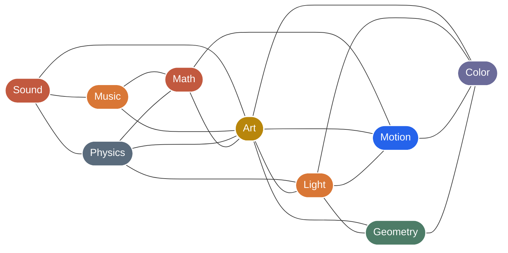
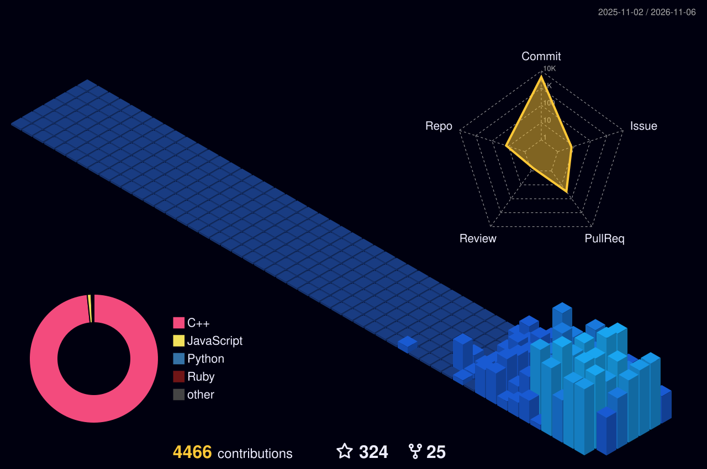

  

  <h1>naman soni (n1m21n)</h1>

  

    <strong>electronic music producer • visual artist • creator of Infinite</strong>
  

  

    <em>house • idm • downtempo • jazztronica • electronica • psychedelic • ambient</em>
  

  

    
    
    
    
  

---

### The Music & The Workstation

> **"I build my own instruments, write my own DSP kernels, and produce my own music."**  
> Every track across my 15 studio albums was produced using self-built modular synthesis patches, custom DSP algorithms, and **[Infinite](https://github.com/n1m21n/Infinite)** — the open-source audiovisual DAW I built from scratch to combine modular sound synthesis and real-time visual generation on a single canvas.

---

### Discography

<table border="0" cellpadding="10" cellspacing="0">
  <tr>
    <td align="center" valign="top" width="33%">
       
      <b>Andhera</b> (2026) 
      idm • ambient • electronica 
      <small>
        <a href="https://open.spotify.com/album/7GFHbn0YZzXIO0SNy5b9kF">Spotify</a> • 
        <a href="https://music.apple.com/in/album/andhera-ep/6768245318">Apple</a> • 
        <a href="https://n1m21n.bandcamp.com/album/andhera">Bandcamp</a>
      </small>
    </td>
    <td align="center" valign="top" width="33%">
       
      <b>Redhand</b> (2025) 
      idm • house • electronica 
      <small>
        <a href="https://open.spotify.com/album/6soWGXV1ZAk86SUCcP9IuM">Spotify</a> • 
        <a href="https://music.apple.com/in/album/redhand/1864736290">Apple</a> • 
        <a href="https://n1m21n.bandcamp.com/album/redhand">Bandcamp</a>
      </small>
    </td>
    <td align="center" valign="top" width="33%">
       
      <b>Paranoia</b> (2025) 
      ambient • psychedelic • idm 
      <small>
        <a href="https://open.spotify.com/album/2fhTKEeKJVWbcszPSHSqTD">Spotify</a> • 
        <a href="https://music.apple.com/in/album/paranoia/1844956850">Apple</a> • 
        <a href="https://n1m21n.bandcamp.com/album/paranoia">Bandcamp</a>
      </small>
    </td>
  </tr>
  <tr>
    <td align="center" valign="top" width="33%">
       
      <b>Awakened</b> (2024) 
      idm • electronica 
      <small>
        <a href="https://open.spotify.com/album/2yc3evZohmnhj3qvvHbyos">Spotify</a> • 
        <a href="https://music.apple.com/in/album/awakened/1760902107">Apple</a> • 
        <a href="https://n1m21n.bandcamp.com/album/awakened">Bandcamp</a>
      </small>
    </td>
    <td align="center" valign="top" width="33%">
       
      <b>Synthetic Vision</b> (2025) 
      psychedelic • electronica • ambient 
      <small>
        <a href="https://open.spotify.com/album/5sDvwsolVqP0pBNS5QGnZ6">Spotify</a> • 
        <a href="https://music.apple.com/in/album/synthetic-vision/1820942202">Apple</a> • 
        <a href="https://n1m21n.bandcamp.com/album/synthetic-vision">Bandcamp</a>
      </small>
    </td>
    <td align="center" valign="top" width="33%">
       
      <b>Circle of Time</b> (2024) 
      jazztronica • downtempo 
      <small>
        <a href="https://open.spotify.com/album/0pk1Q33gQS6jOd1KFdLNkc">Spotify</a> • 
        <a href="https://music.apple.com/in/album/circle-of-time/1771179037">Apple</a> • 
        <a href="https://n1m21n.bandcamp.com/album/circle-of-time-2">Bandcamp</a>
      </small>
    </td>
  </tr>
  <tr>
    <td align="center" valign="top" width="33%">
       
      <b>Rehab</b> (2024) 
      ambient • downtempo 
      <small>
        <a href="https://open.spotify.com/album/00WZ4TByBIbh91WWGbZ24N">Spotify</a> • 
        <a href="https://music.apple.com/in/album/rehab/1742657978">Apple</a> • 
        <a href="https://n1m21n.bandcamp.com/album/rehab">Bandcamp</a>
      </small>
    </td>
    <td align="center" valign="top" width="33%">
       
      <b>Hiraku</b> (2024) 
      electronica • idm 
      <small>
        <a href="https://open.spotify.com/album/2gUNdwlBbVNPkNQxkWErFB">Spotify</a> • 
        <a href="https://music.apple.com/in/album/hiraku/1753044580">Apple</a> • 
        <a href="https://n1m21n.bandcamp.com/album/hiraku">Bandcamp</a>
      </small>
    </td>
    <td align="center" valign="top" width="33%">
       
      <b>Godsdie</b> (2025) 
      ambient • electronica 
      <small>
        <a href="https://open.spotify.com/album/0UALYJdLPYodLfWVLLXk7G">Spotify</a> • 
        <a href="https://music.apple.com/in/album/godsdie/1794224379">Apple</a> • 
        <a href="https://n1m21n.bandcamp.com/album/godsdie">Bandcamp</a>
      </small>
    </td>
  </tr>
  <tr>
    <td align="center" valign="top" width="33%">
       
      <b>Naked Space</b> (2024) 
      ambient • downtempo 
      <small>
        <a href="https://open.spotify.com/album/6Se0loyKIBy5Znzjwdg2dH">Spotify</a> • 
        <a href="https://music.apple.com/in/album/naked-space/1795653113">Apple</a> • 
        <a href="https://n1m21n.bandcamp.com/album/naked-space">Bandcamp</a>
      </small>
    </td>
    <td align="center" valign="top" width="33%">
       
      <b>Realms</b> (2024) 
      ambient • psychedelic 
      <small>
        <a href="https://open.spotify.com/album/4PTKPIdF4TlNEMXCPk1HzB">Spotify</a> • 
        <a href="https://music.apple.com/in/artist/naman/1705841663">Apple</a> • 
        <a href="https://n1m21n.bandcamp.com/">Bandcamp</a>
      </small>
    </td>
    <td align="center" valign="top" width="33%">
       
      <b>Water Computer</b> (2024) 
      idm • electronica 
      <small>
        <a href="https://open.spotify.com/album/3KV84K9aK4wQAjNEsijucF">Spotify</a> • 
        <a href="https://music.apple.com/in/artist/naman/1705841663">Apple</a> • 
        <a href="https://n1m21n.bandcamp.com/">Bandcamp</a>
      </small>
    </td>
  </tr>
</table>

<em>Complete 15-album interactive 3D spatial room available at <a href="https://naman.infinitedevices.org">naman.infinitedevices.org</a>.</em>

---

### The Workstation: [Infinite](https://github.com/n1m21n/Infinite)

> **A unified node-based audiovisual modular workstation for macOS, Windows, and Linux.**  
> Real-time GPU video shaders, procedural 3D geometry and simulations, and a full modular synthesizer rack with AU/VST3 plugin hosting — interconnected through a universal modulation graph.

  

- **Official Website**: [infinitedevices.org](https://infinitedevices.org)
- **Headless CLI & Python SDK**: `pip install infinite-daw`
- **MCP & UTCP Protocol**: `npx -y infinite-engine init` • [utcp.json](https://infinitedevices.org/utcp.json)
- **Free Unlimited Sample Generator**: [infinitedevices.org/samples/](https://infinitedevices.org/samples/)

---

### Connected by Nature

---

### Star History

  <a href="https://star-history.com/#n1m21n/Infinite&Date">
    <picture>
      <source media="(prefers-color-scheme: dark)" srcset="https://api.star-history.com/svg?repos=n1m21n/Infinite&type=Date&theme=dark" />
      <source media="(prefers-color-scheme: light)" srcset="https://api.star-history.com/svg?repos=n1m21n/Infinite&type=Date" />
      
    </picture>
  </a>

---

### Contribution Activity

  <picture>
    <source media="(prefers-color-scheme: dark)" srcset="profile-3d-contrib/profile-night-view.svg">
    <source media="(prefers-color-scheme: light)" srcset="profile-3d-contrib/profile-season.svg">
    
  </picture>

---

### Connect & Follow

- **Spatial 3D Room & Discography**: [naman.infinitedevices.org](https://naman.infinitedevices.org)
- **Spotify**: [Naman on Spotify](https://open.spotify.com/artist/3gugf7oQFbrPsTpNT8EsBO)
- **Apple Music**: [Naman on Apple Music](https://music.apple.com/in/artist/naman/1705841663)
- **Bandcamp**: [n1m21n.bandcamp.com](https://n1m21n.bandcamp.com/)
- **Discord Community**: [Join the Infinite Server](https://discord.gg/wpKdexvhn)
- **Twitter / X**: [@n1m21n](https://x.com/n1m21n)
- **Instagram**: [@n1m21n](https://instagram.com/n1m21n)
- **Email**: namansoniiii21@gmail.com

  All music and software engineered by Naman Soni (n1m21n). Released under open and independent licences.

